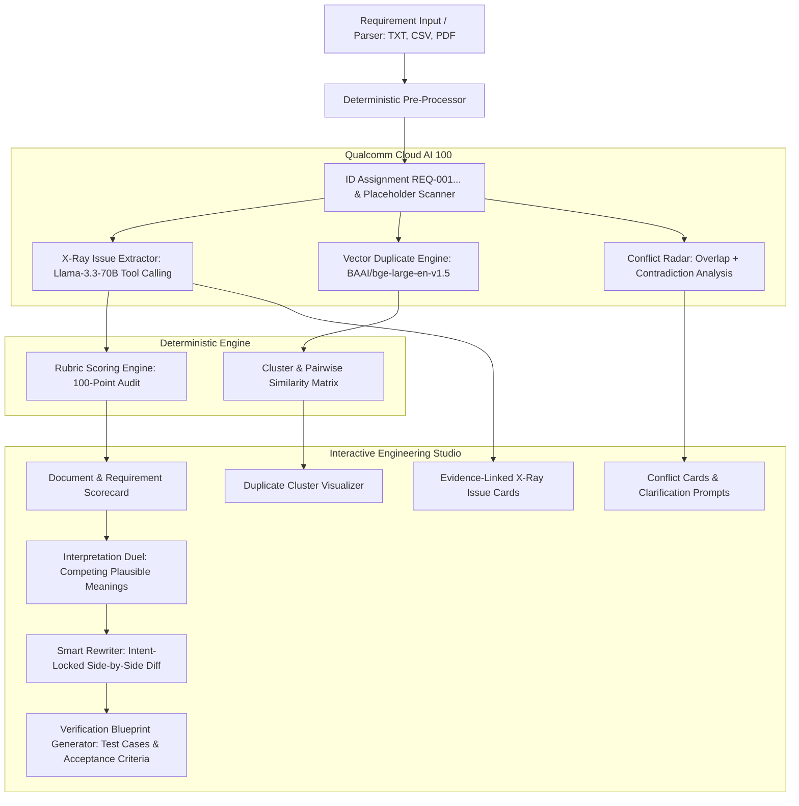

# Requirement Quality Copilot (PSE-01) — Project Master Document

> **Transform rough product requirements into clear, consistent, reviewable, and verification-ready engineering specifications.**

---

## 1. Project Vision & Core Principles

Requirements are the root cause of over 50% of software and hardware engineering defects. Vague phrasing, unstated assumptions, and conflicting constraints lead to millions of dollars in rework. 

**Requirement Quality Copilot** is an evidence-first, explainable engineering assistant powered by **Qualcomm Cloud AI 100** acceleration. It does not replace engineers—it augments them by identifying risks, explaining evidence, asking for missing stakeholder decisions, and generating verification plans.

### Core Design Principles
1. **Evidence First**: Every identified flaw must quote the exact source wording and explain its concrete engineering risk.
2. **Never Fabricate Values**: Missing thresholds, boundary conditions, or stakeholder decisions must become explicit `[TBD: ...]` placeholders or clarification questions—never AI hallucinations.
3. **Deterministic & Explainable Scoring**: Scores come from a documented mathematical rubric with explicit deduction line-items, not an arbitrary model number.
4. **Human In The Loop**: AI rewrites remain drafts until authorized reviewer approval.
5. **Traceability & Auditing**: Preserve original wording, requirement IDs (`REQ-xxx`), versions, and reviewer acceptance justifications.

---

## 2. Core Workflow & Architecture

---

## 3. Detailed Feature Breakdown & Build Priorities

### P0 — Core MVP (Must-Have for Base Functionality)

#### 1. Requirement Input & Document Parser
* **Inputs**: Pasted free-text, CSV, TXT, and PDF uploads.
* **Statement Splitting**: Tokenize and segment documents into distinct requirement records.
* **Metadata & Stable IDs**: Assign sequential, immutable IDs (`REQ-001`, `REQ-002`, ...). Preserve original text and document section references.
* **Classification**: Tag statements as Functional, Performance, Security, Interface, or Constraint.

#### 2. Requirement Quality Scoring Engine (100-Point Audit)
Scores are mathematically calculated from deductions across 5 core dimensions:
* **Clarity (25%)**: Flags ambiguous adjectives/adverbs (*"fast"*, *"robust"*, *"easy"*, *"adequate"*).
* **Verifiability (25%)**: Flags untestable claims lacking objective pass/fail metrics (*"excellent performance"*).
* **Completeness (20%)**: Flags missing actors, conditions, triggers, boundary numbers, or units.
* **Atomicity (15%)**: Flags compound sentences joining multiple distinct obligations with *"and"*, *"as well as"*.
* **Consistency (15%)**: Penalizes internal contradictions with related requirements.
* *Output*: Overall document average, dimension breakdown radar/bars, and line-item deduction receipts.

#### 3. Requirement X-Ray (Issue Detection)
* Highlights the exact substring causing risk with click-to-highlight source linking.
* **Issue Card Fields**:
  - `Issue Type`: Ambiguity, Unverifiability, Incompleteness, Non-atomic, or Placeholder.
  - `Severity`: Blocker, Major, Minor.
  - `Evidence Quote`: Exact substring quote.
  - `Explanation`: Why this causes engineering, testing, or contractual risk.
  - `Action`: Recommended remediation step.
  - `Status`: Open, Accepted with Justification, Resolved.

#### 4. Duplicate Detection Engine
* **Vector Embeddings**: Computes 1024-dimensional embeddings via Qualcomm `BAAI/bge-large-en-v1.5`.
* **Cosine Similarity Matrix**: Evaluates all requirement pairs in $<5\text{ms}$.
* **Thresholds**:
  - $> 0.85$: Probable duplicate (same behavior under same conditions).
  - $0.70 - 0.85$: Related/overlapping intent.
* Grouping into interactive duplicate clusters with merge/retain recommendations.

#### 5. Conflict Radar
* Evaluates pairs sharing common actors and scope for opposing behaviors.
* E.g., `REQ-004` (transmits telemetry in normal mode) vs `REQ-009` (no external transmissions in normal mode).
* Provides conflict cards showing both requirement IDs, quotes, and suggested resolution strategies.

#### 6. Smart Requirement Rewriter
* Generates clear, unambiguous, and testable alternatives.
* **Constraint Rule**: Never invent unstated numbers or boundaries. All missing information must use `[TBD: <parameter>]` syntax.
* **Rewrite Modes**:
  - *Clarity Mode*: Improves grammar and removes vague adjectives.
  - *Testability Mode*: Formulates into formal *"The [Actor] shall [Action] within [TBD: threshold] under [Condition]"* syntax.
  - *Split Mode*: Separates non-atomic compound requirements into sub-requirements (`REQ-001A`, `REQ-001B`).

---

### P1 — High-Impact Differentiators (Pitch Winners)

#### 7. Interpretation Duel (Visual Demo Showstopper)
* Takes an ambiguous requirement and generates **two distinctly different, equally plausible engineering interpretations**.
* *Example*: *"Retain recent diagnostic logs."*
  - **Interpretation A**: Time-based retention (e.g., retain logs from previous 24 hours).
  - **Interpretation B**: Capacity/Count-based retention (e.g., retain latest 1,000 log entries).
* Forces stakeholders to pick an explicit path, resolving disagreement before development starts.

#### 8. Clarification Cards & Decision Memory
* Converts missing information into structured multiple-choice or short-input cards.
* Answers directly update the draft requirement and register in a **Decision Memory log** to ensure cross-project consistency.

#### 9. Intent-Locked Change Validation
* Diffs the original requirement against proposed rewrites using token-level comparison.
* Flags material semantic drift:
  - Altered modal obligation strength (*"shall"* $\to$ *"should"* or *"may"*).
  - Dropped or flipped negations (*"shall not"* $\to$ *"shall"*).
  - Modified numerical thresholds or unit swaps.

#### 10. Verification Blueprint Generator
* Automatically creates a draft verification plan for approved requirements.
* Generates:
  - **Verification Method**: Test, Analysis, Inspection, or Demonstration.
  - **Preconditions & Setup**: Environment and initial state.
  - **Test Cases**: Positive path, Negative/Fault injection, and Boundary condition test cases.
  - **Pass/Fail Acceptance Criteria**.

---

### P2 / P3 — Polish & Lifecycle

#### 11. Dual-Key Governance & Requirement Lifecycle Tracker
* **1-Click Header Persona Switcher**: Seamlessly toggles the workspace view between:
  - `👔 Product Manager`: Formulates business targets, reviews AI-suggested defaults, and commits `🟡 PROVISIONAL_PM` intent.
  - `🛠️ Lead Systems Engineer`: Audits feasibility against physical bus/sensor/battery constraints and clicks `🟢 LOCKED_BASELINE` sign-off.
* **3-State Governance Pipeline**: `FLAGGED_TBD` (🔴) $\to$ `PROVISIONAL_PM` (🟡) $\to$ `LOCKED_BASELINE` (🟢).
* **Audit Trail**: Captures PM author, technical lead approver, engineering rationale, and timestamp.
* **Export**: Certified baselines exportable to structured JSON and CSV reports for DOORS/Jira.

---

## 4. Qualcomm AI 100 Model Configuration & Verified Benchmarks

| Pipeline Stage | Model on Cirrascale AI100 | Method | Verified Latency | Reason / Benchmark Result |
| :--- | :--- | :--- | :--- | :--- |
| **X-Ray Issue Extraction** | `Llama-3.3-70B` | Tool Calling (`submit_xray_issues`) | 2.4s – 7.4s | **100% Grounded Quotes**. Exact verbatim substring matching; zero JSON parse failures. |
| **Duplicate Clustering & RAG** | `BAAI/bge-large-en-v1.5` | `client.embeddings()` + ChromaDB | 1.2s – 2.3s (batch) | **1024-dim Vectors**. Conforms to Qualcomm official `rag_with_chromadb` specification. 0.9209 dupe vs 0.6608 distinct separation. |
| **Conflict Radar** | `Llama-3.3-70B` | Tool Calling (`submit_conflict_analysis`) | 10.9s – 16.8s | Deep logical reasoning detecting physical/timing contradictions across multi-statement specs. |
| **Smart Rewriter** | `Llama-3.3-70B` | Tool Calling (`submit_rewritten_requirements`) | 18.2s – 19.7s | **100% Zero-Fabrication**. Decomposes non-atomic clauses while strictly preserving `[TBD]` markers. |
| **Interpretation Duel** | `Llama-3.1-8B` $\to$ `Llama-3.3-70B` | Tiered Cascade | **2.2s fast path** | Fast 2.2s execution on 8B (~85% cost savings); automatically cascades to 70B if ambiguity is subtle. |
| **Verification Blueprint** | `Llama-3.3-70B` | Tool Calling (`submit_verification_blueprint`) | 7.6s – 17.3s | 100% verifiable test cases with paired positive nominal and boundary/stress procedures. |

> 📄 **Empirical Research Findings**: See [docs/findings/phase_0_5_research_findings.md](file:///home/anair/Desktop/Coding/Oi-Thon/docs/findings/phase_0_5_research_findings.md) for complete empirical data across 12 test cases.
> 📄 **Official Imagine SDK Guide**: See [docs/sdk/README.md](file:///home/anair/Desktop/Coding/Oi-Thon/docs/sdk/README.md) for method signatures, `uv` installation steps, async client patterns, and tool-calling examples.
> 📄 **Model Benchmark & Rejection Analysis**: See [docs/models/selection_justification.md](file:///home/anair/Desktop/Coding/Oi-Thon/docs/models/selection_justification.md) and [docs/models/benchmark_results.md](file:///home/anair/Desktop/Coding/Oi-Thon/docs/models/benchmark_results.md) for empirical benchmark data, latency profiles, and reasons why alternative models (`DeepSeek-R1-Distill-Llama-70B`, `Qwen-QwQ-32B`) were rejected.
> 📄 **REST API Reference**: See [docs/api/README.md](file:///home/anair/Desktop/Coding/Oi-Thon/docs/api/README.md) and [docs/api/endpoints.md](file:///home/anair/Desktop/Coding/Oi-Thon/docs/api/endpoints.md).

---

## 5. Technology Stack & Implementation Architecture

### Backend
* **Language & Framework**: Python 3.11+ with **FastAPI**.
* **Data Validation**: **Pydantic v2** models for strict serialization and OpenAPI documentation.
* **HTTP / AI Client**: `httpx` async client communicating with Cirrascale's Qualcomm Cloud AI Playground endpoints.
* **Math & Vectors**: `numpy` / `scipy` for instant vector cosine similarity calculations.
* **Document Parsing**: `pypdf` for PDF text extraction, `pandas` / `csv` for spreadsheet ingestion.
* **Database / Cache**: SQLite with async SQLAlchemy/SQLModel (zero external server dependencies).

### Frontend
* **Framework**: React 18+ with **Vite**.
* **Styling & Theme**: Modern dark-mode interface with glassmorphic cards, vibrant accent badges, and clean typography.
* **Visual Components**:
  - Score Breakdown Gauge & Radar Charts.
  - Interactive clickable text highlighting for X-Ray issues.
  - Side-by-side diff viewer for Intent-Locked rewrites.
  - Interpretation Duel card selector.
  - Verification Plan table and export modals.

---

## 6. Implementation Milestones

- [x] **Milestone 0: Requirements Analysis & AI Discovery**
  - Analyzed problem statement PDF.
  - Documented Qualcomm Imagine APIs and SDK specifications.
  - Benchmarked live models on Qualcomm Cloud AI100 using API credentials.
- [ ] **Milestone 1: Backend Foundation & Qualcomm Connector**
  - Setup FastAPI app and Pydantic schemas.
  - Implement Qualcomm client wrapper with automatic retry, timeout handling, and mock fallback.
  - Implement Document Parser (pasted text, CSV, TXT, PDF).
- [ ] **Milestone 2: Deterministic Engine & Embeddings**
  - Implement 100-point rubric scoring engine.
  - Implement Vector Duplicate Detection & Clustering using `bge-large`.
- [ ] **Milestone 3: AI Core Features (X-Ray, Rewriter, Conflict, Duel)**
  - Integrate `Llama-3.3-70B` tool calling for X-Ray issue extraction.
  - Integrate Smart Rewriter with Intent-Lock validation.
  - Integrate Interpretation Duel generator.
  - Integrate Verification Blueprint generator.
- [ ] **Milestone 4: Modern Web Frontend**
  - Build interactive UI in React + Vite with dark-mode aesthetic.
  - Connect full end-to-end user workflow: Input $\to$ Audit $\to$ Duel $\to$ Rewrite $\to$ Verification Plan.
- [ ] **Milestone 5: Demo Polish & Sample Datasets**
  - Prepare preloaded realistic requirement datasets (e.g., IoT Device, Medical Device, Automotive Telemetry).
  - Verify offline/fallback demo readiness.
